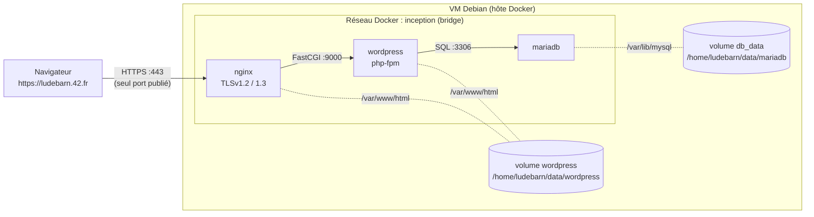

*This project has been created as part of the 42 curriculum by ludebarn*

# Description

### VM vs DOCKER
##### A VM is more isolated but heavier and slower to start.
##### A container is lightweight and quick to setup. But it provides less isolation

The purpose of this project is to create the infrastructure with no dependencies
for a standard website including nginx, mariadb and wordpress.


All of these services are isolated in its own container and they communicate in
the Docker Network with no daemon so each service runs in the foreground
as PID1 as the subject requires, the only entry port
for public is nginx in reverse proxy for the https with the port 443.
### Docker network vs Host network
##### The docker network use his own network(DNS etc..) and allows to communicate with internal
##### ports and with named containers. The host network share the host machine's networks, without isolation
and the subject forbids it

The volumes are volumes named and the storage are available on /home/ludebarn/data of the host machine.
### docker volume vs bind mount
##### Docker manage his volume like an object. Bind mount is just a path from the host

No secrets or .env have been committed during the project. I used secrets for password
because I'm giving .env file for some containers and they don't need to have access of
some password.
### .Env vs secrets
##### A secrets is a file in memory given only to
##### the chosen service and a variable environment is visible with docker inspect and env


## Architecture



# Instructions

To build and start the project, run
```
make up
```

Stop the containers
```
make down
```

Wipes everything, including data, then rebuilds
```
make re
```

Wipes everything
```
make fclean
```

# Resources

For this project I used these documentations:
https://docs.docker.com
https://wordpress.org/documentation/
https://mariadb.com/docs
https://inception.cluzet.fr
https://developer.mozilla.org/fr/docs/Learn_web_development/Core/Styling_basics/Getting_started
https://redis.io/docs/latest/
https://www.adminer.org/

## AI usage
I used Claude for making my static website, DEV_DOC and USER_DOC.
I used it too to explain some concepts like redis, adminer, and the volumes and to proofread my script during all the project.
