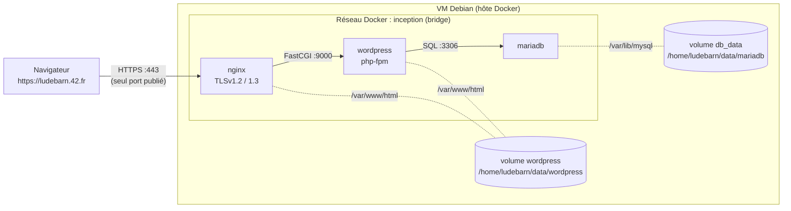

*This project has been created as part of the 42 curriculum by ludebarn*

# Description

What's the difference between VM and Docker ?

The docker is a container and it's major difference is he only a choosen distrib
and he use the OS of the host so he is really more portable than a VM.
The VM has a OS and think is a physical machine with the Hypervisor who communicate
with the phyisical system

The purpose of this project is to create the infrastructure with no dependencies
for a standart website including nginx, mariadb and wordpress.

No secret or .env file has to be commited

All of this tools has to be isolate in a single container, the only entry port
for public has to be nginx in reverse proxy for the https.

The containers can communicate in the Dockernetwork with private port for security



# How to use
For compile this program we need only one command
```
make
```
For down the container
```
make down
```
For restart container
```
make re
```

# Ressources

For this project i used these documentations:

https://docs.docker.com
https://wordpress.org/documentation/
https://mariadb.com/docs
https://inception.cluzet.fr
https://developer.mozilla.org/fr/docs/Learn_web_development/Core/Styling_basics/Getting_started

